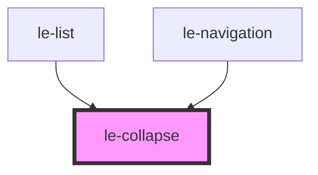

# le-collapse

<!-- Auto Generated Below -->

## Overview

Animated show/hide wrapper.

Supports height collapse (auto->0) and/or fading.

It can follow the state another component publishes on the state bus with
`closed-when="<event>.<field>"`: it is closed while that field is truthy.
- `closed-when="le-header:state.shrunk"` — closed while the header is shrunk;
- `closed-when="le-side-panel:state.visible" closed-when-target="recipes"` —
  closed while the side panel with id `recipes` is visible, i.e. shows its
  content as a replacement when the panel is hidden.

The current state is read right away, so it works even when the collapse
loads after the source published its state.

## Properties

| Property           | Attribute            | Description                                                                                                                                          | Type                  | Default     |
| ------------------ | -------------------- | ---------------------------------------------------------------------------------------------------------------------------------------------------- | --------------------- | ----------- |
| `closed`           | `closed`             | Since Stencil boolean props default to `false` when the attribute is missing. instead of `open` defaulting to `true`, using a `closed` prop.         | `boolean`             | `false`     |
| `closedWhen`       | `closed-when`        | Closes the collapse while a field of a state-bus state is truthy: `<event>.<field>`, e.g. `le-header:state.shrunk` or `le-side-panel:state.visible`. | `string \| undefined` | `undefined` |
| `closedWhenTarget` | `closed-when-target` | Only follow the state published under this key (the source element's id). Without it, any source of the event is followed.                           | `string \| undefined` | `undefined` |
| `noFading`         | `no-fading`          | Stop fading the content when collapsing/expanding.                                                                                                   | `boolean`             | `false`     |
| `scrollDown`       | `scroll-down`        | Whether the content should scroll down from the top when open.                                                                                       | `boolean`             | `false`     |

## Slots

| Slot | Description        |
| ---- | ------------------ |
|      | Content to animate |

## Shadow Parts

| Part       | Description |
| ---------- | ----------- |
| `"region"` |             |

## Dependencies

### Used by

 - [le-list](../le-list)
 - [le-navigation](../le-navigation)

### Graph

----------------------------------------------

*Built with [StencilJS](https://stenciljs.com/)*
