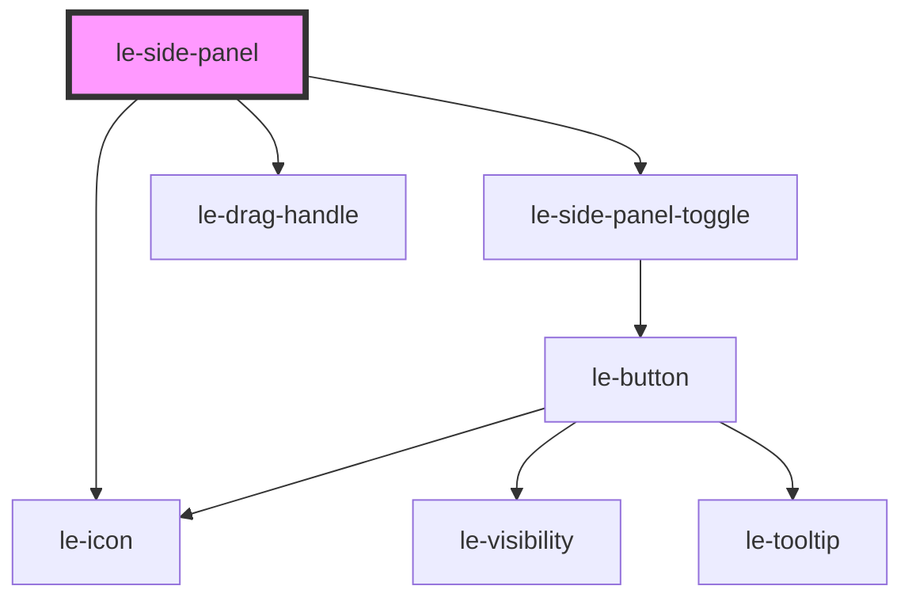

# le-side-panel

<!-- Auto Generated Below -->

## Overview

A side panel next to the main content: inline on wide containers, an overlay
(or a push panel) when the container gets narrower than `collapse-at`.
Toggled by `le-side-panel-toggle` with the same `panel-id`.

Usage notes:
- Show it in a container with a visible edge (a border, a background or a
  shadow): the panel slides in from the container's side, and without a
  visible edge it seems to come from nowhere.
- `--le-side-panel-margin` (or the `margin` prop) is the gap between the
  panel and the container's edges, and accepts any `margin` shorthand —
  e.g. `0 12px 0 0` for a gap on the outer side only. It disappears together
  with the panel; spacing of the main content belongs to the content itself
  (its own padding), so it stays the same whether the panel is shown or not.

## Properties

| Property           | Attribute             | Description                                                                                                                                                                                                           | Type                            | Default        |
| ------------------ | --------------------- | --------------------------------------------------------------------------------------------------------------------------------------------------------------------------------------------------------------------- | ------------------------------- | -------------- |
| `autoHideOnNarrow` | `auto-hide-on-narrow` | When crossing to narrow mode, automatically hide the panel (open=false).                                                                                                                                              | `boolean`                       | `true`         |
| `autoShowOnWide`   | `auto-show-on-wide`   | When crossing to wide mode, automatically show the panel (collapsed=false).                                                                                                                                           | `boolean`                       | `true`         |
| `bottom`           | `bottom`              | Bottom offset for sticky full-height calculations.                                                                                                                                                                    | `"under-footer" \| number`      | `0`            |
| `collapseAt`       | `collapse-at`         | Width breakpoint (in px or a CSS var like `--le-breakpoint-md`) below which the panel enters "narrow" mode.                                                                                                           | `string \| undefined`           | `undefined`    |
| `collapsed`        | `collapsed`           | Panel collapsed state for wide mode (fully hidden).                                                                                                                                                                   | `boolean`                       | `false`        |
| `fullHeight`       | `full-height`         | Whether the sticky panel should stretch to full height.                                                                                                                                                               | `boolean`                       | `false`        |
| `margin`           | `margin`              | Gap between the panel and the container's edges (sets `--le-side-panel-margin`). A number is taken as px; a string is any CSS `margin` value, including shorthand (e.g. `16px`, `var(--le-spacing-2)`, `0 12px 0 0`). | `number \| string \| undefined` | `undefined`    |
| `maxPanelWidth`    | `max-panel-width`     | Maximum allowed width when resizable.                                                                                                                                                                                 | `number`                        | `420`          |
| `minPanelHeight`   | `min-panel-height`    | Minimum panel height (px) when sticky full-height logic is active.                                                                                                                                                    | `number`                        | `200`          |
| `minPanelWidth`    | `min-panel-width`     | Minimum allowed width when resizable.                                                                                                                                                                                 | `number`                        | `220`          |
| `narrowBehavior`   | `narrow-behavior`     | Behavior when in narrow mode.                                                                                                                                                                                         | `"overlay" \| "push"`           | `'overlay'`    |
| `open`             | `open`                | Panel open state for narrow mode. - overlay: controls modal drawer visibility - push: controls whether panel is shown (non-modal)                                                                                     | `boolean`                       | `false`        |
| `panelId`          | `panel-id`            | Optional id used to match toggle requests. If set, the panel only responds to toggle events with the same `panelId`.                                                                                                  | `string \| undefined`           | `undefined`    |
| `panelLabel`       | `panel-label`         | Accessible label for the panel navigation region.                                                                                                                                                                     | `string`                        | `'Navigation'` |
| `panelWidth`       | `panel-width`         | Default panel width in pixels.                                                                                                                                                                                        | `number`                        | `280`          |
| `persistKey`       | `persist-key`         | When set, panel width + collapsed state are persisted in localStorage.                                                                                                                                                | `string \| undefined`           | `undefined`    |
| `resizable`        | `resizable`           | Allows users to resize the panel by dragging its edge.                                                                                                                                                                | `boolean`                       | `false`        |
| `showCloseButton`  | `show-close-button`   | Show a close button inside the panel (primarily used in narrow overlay mode).                                                                                                                                         | `boolean`                       | `true`         |
| `side`             | `side`                | Which side the panel is attached to.                                                                                                                                                                                  | `"end" \| "start"`              | `'start'`      |
| `sticky`           | `sticky`              | Whether the panel is sticky (remains visible when scrolling).                                                                                                                                                         | `boolean`                       | `false`        |
| `top`              | `top`                 | Top offset for the sticky panel.                                                                                                                                                                                      | `"under-header" \| number`      | `0`            |

## Events

| Event                        | Description | Type                                                                  |
| ---------------------------- | ----------- | --------------------------------------------------------------------- |
| `leSidePanelCollapsedChange` |             | `CustomEvent<{ collapsed: boolean; panelId?: string \| undefined; }>` |
| `leSidePanelOpenChange`      |             | `CustomEvent<{ open: boolean; panelId?: string \| undefined; }>`      |
| `leSidePanelWidthChange`     |             | `CustomEvent<{ width: number; panelId?: string \| undefined; }>`      |

## Slots

| Slot           | Description                                    |
| -------------- | ---------------------------------------------- |
|                | Main content                                   |
| `"close-icon"` | Icon of the close button shown in overlay mode |
| `"panel"`      | Panel content                                  |

## Shadow Parts

| Part               | Description |
| ------------------ | ----------- |
| `"close-button"`   |             |
| `"content"`        |             |
| `"inline-panel"`   |             |
| `"overlay"`        |             |
| `"panel"`          |             |
| `"panel-scroller"` |             |
| `"resize-handle"`  |             |
| `"scrim"`          |             |

## Dependencies

### Depends on

- [le-side-panel-toggle](../le-side-panel-toggle)
- [le-icon](../le-icon)
- [le-drag-handle](../le-drag-handle)

### Graph

----------------------------------------------

*Built with [StencilJS](https://stenciljs.com/)*
