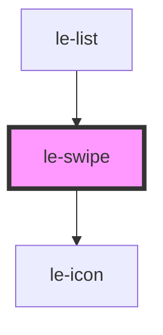

# le-swipe

<!-- Auto Generated Below -->

## Overview

Reveals action buttons behind its content when swiped horizontally — by touch or by
horizontal scrolling on a trackpad / Magic Mouse. Mouse dragging is left to the content
(e.g. selection).

'start' actions sit at the inline start (left in LTR) and are revealed by swiping towards
the end; 'end' actions the other way. A side without actions does not swipe. Pulling past
the buttons runs the side's `full` action.

## Properties

| Property       | Attribute      | Description                                        | Type              | Default |
| -------------- | -------------- | -------------------------------------------------- | ----------------- | ------- |
| `actionWidth`  | `action-width` | Width of one action button in pixels               | `number`          | `72`    |
| `endActions`   | --             | Actions revealed at the inline end (right in LTR)  | `LeSwipeAction[]` | `[]`    |
| `startActions` | --             | Actions revealed at the inline start (left in LTR) | `LeSwipeAction[]` | `[]`    |

## Events

| Event           | Description                                                           | Type                                                |
| --------------- | --------------------------------------------------------------------- | --------------------------------------------------- |
| `leSwipeAction` | Emitted when an action runs, by tapping its button or by a full swipe | `CustomEvent<LeSwipeActionDetail>`                  |
| `leSwipeChange` | Emitted when the swipe opens on one side or closes                    | `CustomEvent<{ open?: LeSwipeSide \| undefined; }>` |

## Methods

### `close() => Promise<void>`

Closes the swipe

#### Returns

Type: `Promise<void>`

### `open(side: LeSwipeSide) => Promise<void>`

Opens the swipe on the given side, showing its buttons

#### Parameters

| Name   | Type               | Description |
| ------ | ------------------ | ----------- |
| `side` | `"start" \| "end"` |             |

#### Returns

Type: `Promise<void>`

## Slots

| Slot | Description           |
| ---- | --------------------- |
|      | The swipeable content |

## Dependencies

### Used by

 - [le-list](../le-list)

### Depends on

- [le-icon](../le-icon)

### Graph

----------------------------------------------

*Built with [StencilJS](https://stenciljs.com/)*
